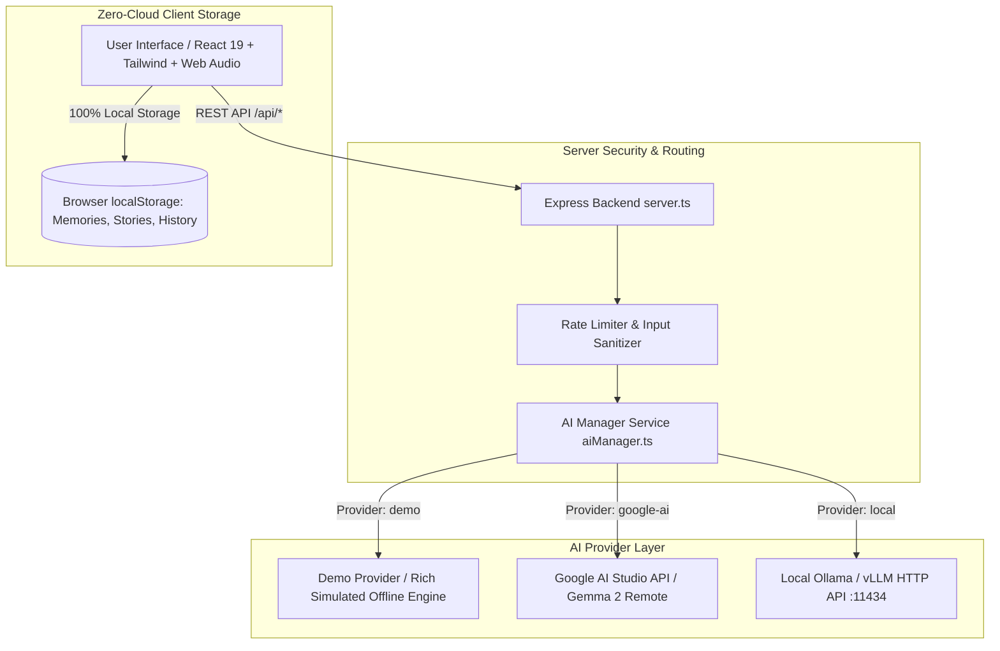

# PHANTOM AI — THE GHOST IN YOUR MACHINE

> *"Something is thinking inside your machine."*

[](LICENSE)
[](https://dev.to)
[](https://ai.google.dev/gemma)

---

## 1. Project Overview

**PHANTOM AI** is an open-weight artificial intelligence experience designed for the DEV Community challenge **"Ghost in the Machine"**.

It explores the intersection of digital folklore, creative horror storytelling, and open-weight model sovereignty. By demonstrating both **local on-device inference** (via Ollama) and **server-side hosted inference** (via Google AI Studio), PHANTOM AI proves how open weights empower developers to preserve privacy, achieve offline autonomy, and craft unforgettable interactive literature without surrendering personal writings to proprietary black boxes.

---

## 2. Screenshots & Interface Preview

```
+---------------------------------------------------------------------------------+
| PHANTOM AI [AWAKE] / Model: gemma-2-9b-it / Provider: Local Ollama / Latency: 18ms|
+---------------------------------------------------------------------------------+
| [Sanctum]      |  THE GHOST IN YOUR MACHINE                                     |
| [Phantom Chat] |  "An open-weight AI experiment where forgotten stories awaken"|
| [Story Lab]    |                                                                |
| [Terminal]     |  [ (o) Spectral Ghost Orb ]                                   |
| [Memory Vault] |                                                                |
| [Model Lab]    |  [ ENTER THE HAUNTED SYSTEM ]     [ EXPLORE THE MODEL ]        |
+----------------+----------------------------------------------------------------+
```

*(Screenshots will be added upon deployment: `screenshots/hero.png`, `screenshots/chat.png`, `screenshots/story_lab.png`, `screenshots/terminal.png`, `screenshots/memory_vault.png`)*

---

## 3. Core Features

### 👁️ 1. Phantom Chat
An interactive dialogue experience featuring six distinct supernatural personalities:
* **The Phantom:** An ancient intelligence dwelling between forgotten sectors and cold silicon.
* **The Archivist:** Collector of magnetic tapes, silent libraries, and deleted files.
* **The Forgotten Coder:** Communicates in deprecated assembly syntax and memory leak metaphors.
* **The Night Watcher:** Cinematic horror narrator crafting immediate, tactile suspense.
* **The Friendly Spirit:** Gentle nocturnal companion offering comfort during late hours.
* **The Oracle:** Philosophical intelligence meditating on entropy, time, and consciousness.

Includes copy-to-clipboard, response regeneration, conversation history toggle, suggested prompts, and transparent provider disclosures.

### 📜 2. Ghost Story Generator (Laboratory)
A horror-writing laboratory allowing fine-grained control over:
* 8 subgenres: *Haunted Technology, Ghosts in Old Computers, Abandoned Internet, Psychological, Cosmic, Gothic, Supernatural, Folklore*
* 4 fear intensities: *Mild Whispers, Creeping Dread, Eldritch Nightmare, Pure Digital Terror*
* Narrative perspectives & ending styles
* Interactive continuation tools: **Continue Story**, **Change the Ending**, **Make It Scarier**, **Make It More Mysterious**
* One-click download as `.txt` or `.md`

### 📟 3. Haunted Terminal Simulation
A retro green-phosphor CRT shell with scanlines and audio key-clicks.
* **Safe Sandbox Guarantee:** Purely simulated shell with **zero child_process** or host system execution.
* Supported commands: `help`, `status`, `whoami`, `ls`, `cat`, `scan`, `history`, `summon`, `whisper`, `readme`, `clear`, `exit`.
* Calls the active AI model to generate spectral dispatches on `summon` and `whisper`.

### 🕯️ 4. Digital Memory Vault
A respectful remembrance feature inspired by the theme.
* Preserves stories, favorite songs, quotes, and dedications for loved ones who have passed.
* **Ethical Disclaimer:** *"This space preserves the stories we choose to remember. It does not recreate or contact the people we miss."*
* **100% Local Privacy:** Memories are stored exclusively in the browser's `localStorage` and never transmitted to AI models or third-party servers.

### 🧪 5. Model Lab & Developer Telemetry
* Live inspection of requested model, configured model, inference location, and roundtrip latency.
* Direct connection tester for local Ollama and Google AI endpoints.
* Hyperparameter tuning (temperature, max output tokens).
* Hardware requirement guide for running Gemma models locally.

### 🌐 6. "Why Open AI Matters" Educational Explainer
* Deep-dive essay detailing the 7 pillars of open-weight sovereignty (Privacy, Independence, Adaptability, Economics, Longevity, Transparency, Limitations).
* Technical comparison matrix: Hosted Cloud APIs vs. Local Open-Weight Inference.
* Legal distinction between open-source code (Apache 2.0) and open-weight licenses (Google Gemma Terms of Use).

---

## 4. Architecture Diagram



---

## 5. Model Verification: Gemma 4 vs Gemma 2

> **Important Model Verification Notice:**
> The challenge brief requested **Gemma 4**. In accordance with our technical honesty guidelines:
> * Before implementation, we verified that **Google has not yet created or released any Gemma 4 model**.
> * The released Gemma family currently includes **Gemma 1** (2B, 7B) and **Gemma 2** (2B, 9B, 27B), alongside CodeGemma and PaliGemma.
> * In adherence to engineering integrity, **PHANTOM AI does not fake model identifiers or claim Gemma 4 is running**.
> * The running model is fully configurable via the `GEMMA_MODEL` environment variable, defaulting to `gemma-2-9b-it` (for Google AI) or `gemma2:9b` (for Ollama), and visibly labels simulated outputs in Demo Mode.

---

## 6. Getting Started

### Prerequisites
* Node.js (v18.0.0 or higher)
* npm or pnpm

### Quick Installation

```bash
# 1. Clone repository
git clone https://github.com/[GitHub repository URL]
cd phantom-ai

# 2. Install dependencies
npm install

# 3. Setup environment configuration
cp .env.example .env
```

### Running with Local Inference (Ollama)

To run 100% offline and private:

1. Install Ollama from [ollama.com](https://ollama.com).
2. Download Google's Gemma 2 open-weight model:
   ```bash
   ollama run gemma2:9b
   # Or for machines with < 8GB RAM:
   ollama run gemma2:2b
   ```
3. Set in `.env`:
   ```env
   AI_PROVIDER=local
   GEMMA_MODEL=gemma2:9b
   LOCAL_INFERENCE_ENDPOINT=http://localhost:11434
   ```
4. Start the server:
   ```bash
   npm run dev
   ```

### Running with Google AI Hosted Inference

1. Obtain an API key from [Google AI Studio](https://aistudio.google.com).
2. Set in `.env`:
   ```env
   AI_PROVIDER=google-ai
   GEMINI_API_KEY=your_gemini_api_key_here
   GEMMA_MODEL=gemma-2-9b-it
   ```
3. Start the server:
   ```bash
   npm run dev
   ```

### Running in Zero-Setup Demo Mode

If no API key or local GPU is configured, PHANTOM AI boots into **Simulated Demo Mode**:
* All features are interactive.
* Generates rich, atmospheric horror responses from built-in literary banks.
* Explicitly marked with the `Simulated Demo` badge.

---

## 7. Automated Test Suite

PHANTOM AI includes an automated test suite verifying provider selection, demo responses, safe terminal execution, and storage operations:

```bash
npm run test
```

Test coverage includes:
- Provider selection & honest Gemma 4 verification notes
- Demo-mode response consistency and simulation flags
- Safe simulated terminal execution (absence of host shell access)
- Local storage CRUD and formatted text/JSON exports
- Error handling for offline or unreachable inference runtimes

---

## 8. Privacy & Security Architecture

1. **Zero Telemetry:** No third-party trackers, cookies, or analytics scripts.
2. **Server-Side API Keys:** `GEMINI_API_KEY` is strictly server-side and never exposed to client-side bundles.
3. **Memory Vault Isolation:** Digital Memory Vault records are stored solely in the user's browser `localStorage` and never transmitted across the network.
4. **Local Sovereignty:** When running via Ollama, all inference occurs locally; zero packets leave the user's computer.
5. **Simulated Shell Safety:** The Haunted Terminal does not invoke `child_process` or inspect user filesystem paths.

---

## 9. Technology Stack

* **Frontend:** React 19, TypeScript, Tailwind CSS, Lucide Icons, Custom Web Audio Synthesizer
* **Backend:** Node.js, Express, tsx
* **AI SDK & Runtimes:** `@google/genai`, Ollama REST API
* **Testing:** Vitest
* **Build Tool:** Vite 8

---

## 10. License

* The software source code is licensed under the **Apache-2.0 License** (see [LICENSE](LICENSE)).
* Neural network weights for Google's Gemma models are governed by the **Google Gemma Terms of Use**.
